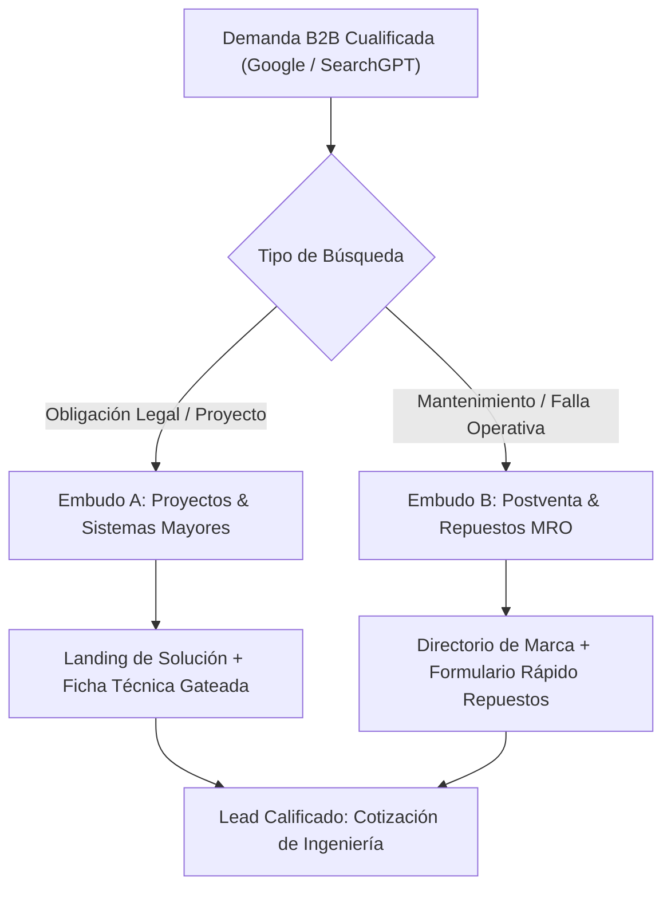
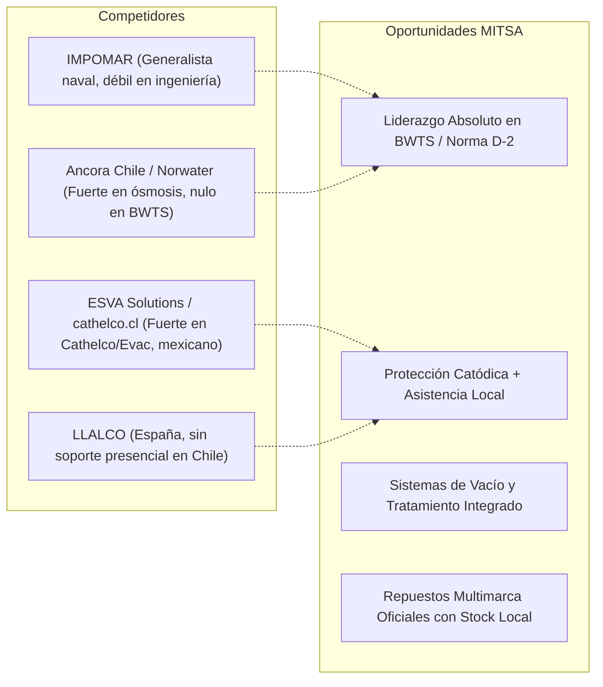
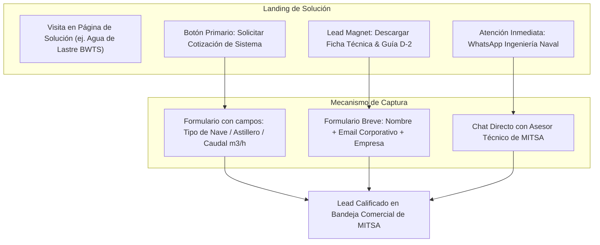

# Estrategia de Posicionamiento SEO & Generación de Leads B2B: mitsa.org
**Documento Maestro de Investigación de Mercado, Competencia en Internet y Arquitectura de Palabras Clave**  
**Cliente:** MITSA (mitsa.org)  
**Agencia:** AplicacionesWeb (aplicacionesweb.cl)  
**Fecha:** Octubre 2026  
**Alcance:** Mercado Chileno (Prioritario) & Clústeres Geográficos LatAm (Perú, Colombia, Cono Sur)  
**Metodología:** Ubersuggest Framework + SEO-pro Plugin (Search Intent B2B, SERP Gap Analysis & AI Overviews Readiness)

---

## 1. Resumen Ejecutivo & Tesis de Posicionamiento

El servicio de posicionamiento SEO prestado a **MITSA** tiene como objetivo primordial la **captación de leads B2B de alto valor comercial** (contratos de suministro de sistemas, retrofits en astilleros, mantenimiento preventivo de dique seco y venta recurrente de repuestos originales).

### La Ventaja Competitiva Defendible de MITSA: *El Factor Regulatorio*
En el sector marítimo e industrial, los clientes no compran equipos por curiosidad estética; compran por **obligación legal estricta y continuidad operativa**.
1. **Convenio BWM (OMI) - Norma D-2:** Todas las naves que realizan descargas de agua de lastre en puertos chilenos deben contar con un sistema BWTS homologado. La **DIRECTEMAR** fiscaliza con fluorómetros portátiles en Valparaíso, San Antonio y San Vicente. MITSA representa en exclusiva a **Erma First** (sistema BWTS FIT con certificación IMO y USCG).
2. **Circular A-52/007 (DIRECTEMAR):** Regulación sobre bioincrustaciones y prevención de especies invasoras en cascos. Impulsa la demanda de sistemas **ICCP**, **ánodos de sacrificio** y sistemas **ICAF/MGPS**.
3. **Convenio MARPOL - Anexo IV (Aguas Servidas):** Obligación de plantas de tratamiento certificadas para descargas de efluentes marinos en aguas jurisdiccionales. MITSA integra soluciones biológicas y de vacío de clase mundial.

---

## 2. Análisis del Mercado & Buyer Personas B2B

### Sectores Clave de Demanda en Chile y la Región
* **Transporte Marítimo y Navieras:** Armadores de buques portacontenedores, graneleros, remolcadores portuarios y barcazas de cabotaje que operan en puertos chilenos e internacionales.
* **Astilleros y Reparación Naval:** ASMAR (Talcahuano, Valparaíso, Magallanes) y astilleros privados. Necesitan especificaciones para proyectos nuevos y retrofits en dique seco.
* **Industria Acuícola y Wellboats (Puerto Montt - Magallanes):** Embarcaciones de transporte de salmón vivo y artefactos navales con requerimientos críticos de tratamiento de agua, desinfección y bombas sanitarias.
* **Defensa y Armada de Chile:** Fragatas, patrulleros OPV y buques auxiliares con altos estándares de certificación naval (DNV, Lloyd's Register, ABS).
* **Industria e Instalaciones Terrestres:** Minería, plantas desalinizadoras y edificaciones que requieren drenajes de acero inoxidable de alta exigencia (Blücher) y sistemas de vacío.

### Matriz de Buyer Personas

| Perfil | Rol en la Compra | Gatillador de Búsqueda | Qué necesita encontrar para convertir |
| :--- | :--- | :--- | :--- |
| **Superintendente Técnico / Port Captain** | Decisor / Aprobador | Inspección inminente de DIRECTEMAR, falla en auditoría de bandera, renovación de certificados OMI. | Certificaciones DNV/ABS/IMO, cumplimiento normativo chileno, tiempo de entrega y soporte local. |
| **Jefe de Dique / Ingeniero de Astillero** | Especificador técnico | Proyecto de construcción o carena; necesidad de planos 3D, caudales, dimensiones y consumo eléctrico. | Fichas técnicas descargables, diagramas P&ID, asistencia técnica para montaje e integración. |
| **Jefe de Mantenimiento & Flota** | Comprador recurrente | Falla de bomba, desgaste de ánodos, saturación de filtros, alarmas en panel de control. | Identificación precisa por marca/modelo, stock de repuestos en Chile, servicio técnico autorizado. |
| **Gerente de Abastecimiento / MRO** | Ejecutor de compra | Solicitud de cotización formal, comparación de proveedores, homologación de proveedor nacional. | Cotización rápida en CLP/USD, facturación local, seriedad corporativa y solvencia técnica. |

---

## 3. Radiografía de la Competencia en Internet (SERP Benchmarking)

MITSA no tenía claridad sobre quién compite en internet. A continuación se desglosan los competidores reales detectados en las SERPs chilenas y latinoamericanas, identificando sus fortalezas y sus brechas operativas:

### 1. IMPOMAR (`impomar.cl`)
* **Perfil:** El actor tradicional más antiguo en proveeduría naval en Chile.
* **Fortalezas:** Reconocimiento de marca histórica en suministros generales (balsas SOLAS, cabos, anclas, válvulas).
* **Vulnerabilidades:** Su sitio web es un catálogo plano con baja profundidad técnica; no atacan términos regulatorios avanzados (BWTS, norma D-2, cálculo de corriente de ánodos) ni cuentan con contenidos de ingeniería.
* **Estrategia MITSA:** No competir en suministros genéricos (ferretería marina). Superarlos ampliamente en términos de ingeniería, plantas de tratamiento y cumplimiento normativo.

### 2. Ancora Chile (`ancora.cl`)
* **Perfil:** Empresa especializada en ingeniería marina con base en Chile (representantes de Norwater y bombas Desmi).
* **Fortalezas:** Posicionamiento fuerte en **ósmosis inversa marina** y plantas desalinizadoras para buques.
* **Vulnerabilidades:** No cubren sistemas de tratamiento de agua de lastre (BWTS) de vanguardia ni sistemas sanitarios de vacío; escasa optimización SEO semántica.
* **Estrategia MITSA:** Competir en ósmosis marina mediante diferenciación de marca y soporte en dique; dominarlos en BWTS y protección catódica.

### 3. ESVA Solutions (`cathelco.cl` / `esvasolutions.com`)
* **Perfil:** Distribuidor de Cathelco y Evac para México y Latinoamérica con presencia de contacto en Chile.
* **Fortalezas:** Tienen indexado el dominio `cathelco.cl` con buen contenido técnico sobre ICCP y sistemas Evac.
* **Vulnerabilidades:** Operación centralizada en México; carecen de un despliegue editorial regulatorio chileno enfocado en DIRECTEMAR o astilleros locales.
* **Estrategia MITSA:** Proyectar la solvencia técnica presencial de MITSA en Chile (sede en Reñaca, cobertura directa de Arica a Punta Arenas) y posicionar marcas alternativas y complementarias de alta reputación (EPE, Uson Marine, Herborner).

### 4. LLALCO España (`llalco.com`)
* **Perfil:** Fabricante y distribuidor internacional de protección catódica y equipos marinos con sitio en español.
* **Fortalezas:** Muy buen contenido técnico sobre ICCP y sistemas anti-incrustantes.
* **Vulnerabilidades:** No tienen presencia física en Chile; tiempos de respuesta lentos y aranceles de importación directa para el comprador local.
* **Estrategia MITSA:** Capturar la intención transaccional local agregando modificadores geográficos ("en Chile", "para astilleros chilenos", "soporte ASMAR") donde LLALCO no puede rankear.

---

## 4. Investigación de Palabras Clave (Metodología Ubersuggest & SEO-pro)

### Fórmula de Priorización B2B (Opportunity Score)
Para el B2B industrial, los grandes volúmenes genéricos suelen traer tráfico no calificado (estudiantes, curiosos). La fórmula aplicada pondera fuertemente la **Intención Transaccional/Regulatoria ($I$)** sobre la **Dificultad SEO ($SD$)**:

$$\text{Opportunity Score} = \frac{\text{Volumen Mensual} \times \text{Factor de Intención B2B (1 a 5)}}{\text{Search Difficulty (SD)}}$$

* **Factor 5:** Intención Transaccional Regulatoria / Cotización de Sistema (alta probabilidad de lead millonario).
* **Factor 4:** Búsqueda Comercial de Marca Técnica / Repuesto específico.
* **Factor 3:** Comparativa técnica / especificación de dique.
* **Factor 1-2:** Búsqueda puramente informacional.

---

### Clúster 1: Cumplimiento Regulatorio & Fiscalización Marítima (Tier 1 - Prioridad Máxima)
*Son las búsquedas que realizan navieras y astilleros cuando enfrentan una auditoría inminente o preparan una nave para dique.*

| Palabra Clave | Volumen Estimado (CL+LatAm) | Intención | SD | Oportunidad | URL Destino en mitsa.org |
| :--- | :---: | :--- | :---: | :---: | :--- |
| **norma d2 agua de lastre chile** | 170 | Transaccional / Legal | 18 | **Extrema** | `/soluciones/agua-de-lastre-bwts/` |
| **sistema bwts chile** | 140 | Transaccional | 16 | **Extrema** | `/soluciones/agua-de-lastre-bwts/` |
| **tratamiento agua de lastre buques** | 290 | Comercial Técnico | 24 | **Muy Alta** | `/soluciones/agua-de-lastre-bwts/` |
| **convenio bwm directemar chile** | 90 | Regulatorio | 12 | **Extrema** | `/centro-tecnico/norma-d2-bwm-chile/` |
| **circular a 52 007 directemar bioincrustaciones** | 110 | Regulatorio / Cumplimiento | 14 | **Extrema** | `/soluciones/bioincrustaciones-icaf/` |
| **marpol anexo iv tratamiento aguas servidas** | 210 | Comercial Técnico | 22 | **Muy Alta** | `/soluciones/tratamiento-de-aguas-residuales/` |
| **plan gestion agua de lastre bwmp chile** | 80 | Transaccional | 15 | **Alta** | `/soluciones/agua-de-lastre-bwts/` |

---

### Clúster 2: Sistemas Mayores de Tratamiento de Aguas & Sanitarios Navales (Tier 1)
*Búsquedas enfocadas en compra de equipamiento para astilleros, ingeniería de naves y wellboats.*

| Palabra Clave | Volumen Estimado | Intención | SD | Oportunidad | URL Destino en mitsa.org |
| :--- | :---: | :--- | :---: | :---: | :--- |
| **planta de tratamiento de aguas servidas buques** | 260 | Transaccional | 25 | **Muy Alta** | `/soluciones/tratamiento-de-aguas-residuales/` |
| **sistemas sanitarios al vacio barcos** | 190 | Transaccional | 21 | **Muy Alta** | `/soluciones/sistemas-sanitarios-al-vacio/` |
| **inodoros de vacio marinos chile** | 70 | Transaccional | 14 | **Alta** | `/soluciones/sistemas-sanitarios-al-vacio/` |
| **osmosis inversa marina chile** | 320 | Comercial / Transaccional | 29 | **Alta** | `/soluciones/agua-dulce-osmosis/` *(A crear)* |
| **generador de agua dulce buques desalinizador** | 180 | Comercial Técnico | 22 | **Alta** | `/soluciones/agua-dulce-osmosis/` |
| **plantas separadoras de agua sentina marina** | 140 | Transaccional | 20 | **Alta** | `/soluciones/separadores-sentina/` |

---

### Clúster 3: Protección de Casco, Corrosión & Obra Viva (Tier 1 y 2)
*Dirigido a superintendentes de flota, inspectores de casco y faenas de carena en dique seco.*

| Palabra Clave | Volumen Estimado | Intención | SD | Oportunidad | URL Destino en mitsa.org |
| :--- | :---: | :--- | :---: | :---: | :--- |
| **proteccion catodica iccp naval chile** | 160 | Transaccional Técnico | 19 | **Muy Alta** | `/soluciones/proteccion-catodica-iccp/` |
| **sistema iccp para buques astillero** | 130 | Transaccional | 22 | **Muy Alta** | `/soluciones/proteccion-catodica-iccp/` |
| **anodos de sacrificio para barcos chile** | 390 | Comercial | 28 | **Alta** | `/soluciones/proteccion-catodica-iccp/` |
| **sistema antiincrustante icaf mgps naval** | 110 | Transaccional Técnico | 16 | **Muy Alta** | `/soluciones/bioincrustaciones-icaf/` |
| **fluidos anticorrosion para cascos y buques** | 90 | Comercial | 15 | **Alta** | `/soluciones/revestimientos-y-superficies/` |
| **anodos de zinc naval valparaiso talcahuano** | 80 | Transaccional Local | 12 | **Extrema** | `/soluciones/proteccion-catodica-iccp/` |

---

### Clúster 4: Equipamiento Auxiliar, Bombas y Drenajes Industriales (Tier 2)
*Ingeniería de fluidos y equipamiento para instalaciones exigentes en tierra y a bordo.*

| Palabra Clave | Volumen Estimado | Intención | SD | Oportunidad | URL Destino en mitsa.org |
| :--- | :---: | :--- | :---: | :---: | :--- |
| **intercambiadores de calor navales chile** | 140 | Transaccional Técnico | 18 | **Muy Alta** | `/soluciones/equipamiento-auxiliar/` |
| **bombas marinas industriales chile** | 220 | Comercial | 26 | **Media** | `/soluciones/equipamiento-auxiliar/` |
| **drenajes de acero inoxidable industriales blucher**| 130 | Comercial de Marca | 17 | **Muy Alta** | `/soluciones/drenajes-inoxidables/` |
| **canaletas inoxidables higienicas plantas alimentos**| 180 | Transaccional | 23 | **Alta** | `/soluciones/drenajes-inoxidables/` |
| **bombas herborner pumpen chile repuestos** | 50 | Navegacional / Repuesto | 9 | **Extrema** | `/representadas/` |

---

### Clúster 5: Clúster Geográfico B2B (Chile & Expansión LatAm)
*Búsquedas combinadas con ubicaciones estratégicas de puertos, astilleros y centros marítimos.*

| Término B2B Geográfico | Hub Logístico / Marítimo | Aplicación Principal | Intención |
| :--- | :--- | :--- | :--- |
| **equipamiento naval Valparaíso / San Antonio** | Centro de Chile (Comercio exterior) | Suministro rápido de repuestos, plantas de lastre y certificación. | Transaccional Inmediata |
| **proveedores astillero Talcahuano ASMAR** | Biobío (Construcción naval militar/pesquera) | Proyectos de dique seco, ICCP, intercambiadores de calor. | Especificación Proyecto |
| **tratamiento de aguas wellboats Puerto Montt** | Los Lagos (Acuicultura / Salmonicultura) | Desinfección de agua, plantas de vacío, bioincrustaciones. | Transaccional Industrial |
| **repuestos navales Punta Arenas Magallanes** | Extremo Sur (Rutas australes / Antártica) | Bombas de achique, separadores de sentina, aguas servidas. | Mantenimiento Crítico |
| **sistemas BWTS Perú / astillero SIMA Callao** | Perú (Expansión LatAm) | Naves de cabotaje y pesqueras obligadas por normativa OMI. | Proyecto Regional |
| **tratamiento aguas buques Colombia COTECMAR** | Colombia (Expansión LatAm) | Construcción de patrulleros y buques fluviales/marítimos. | Proyecto Regional |

---

## 5. Embudo de Conversión & Generación de Leads en mitsa.org

Tener tráfico no genera facturación si la página no convierte visitas técnicas en solicitudes de cotización formales. Se implementará una arquitectura de conversión de dos vías:

### Acciones Concretas de Optimización On-Page en `mitsa.org`
1. **Unificación de Snippets (Title & Meta Description):**
   * En lugar del genérico actual (*"MITSA Chile | Ingeniería & Soluciones"*), los títulos deben incorporar la keyword primaria transaccional y la propuesta de valor:
   * *Ejemplo Home:* `MITSA | Equipamiento Naval, Sistemas de Tratamiento de Aguas e Ingeniería Marítima` (68 chars).
   * *Ejemplo Solución BWTS:* `Sistemas BWTS en Chile: Tratamiento de Agua de Lastre Norma D-2 | MITSA` (68 chars).
   * *Ejemplo ICCP:* `Protección Catódica ICCP Naval y Ánodos de Sacrificio en Chile | MITSA` (68 chars).
2. **Jerarquía Semántica de Encabezados (H1-H3):**
   * Un único H1 por página que incluya la palabra clave transaccional exacta.
   * H2 estructurados según las preguntas del comprador técnico (*"Cumplimiento de la Norma D-2 en Puertos Chilenos"*, *"Especificaciones Técnicas del Sistema Erma First FIT"*, *"Soporte en Astilleros y Dique Seco"*).
3. **Formularios Diferenciados de Alta Conversión:**
   * **Formulario A (Proyectos Mayores):** Incluye campos como *Tipo de nave*, *Astillero de montaje*, *Caudal requerido ($m^3/h$)* y *Fecha límite de entrega*.
   * **Formulario B (Repuestos MRO):** Permite subir una fotografía de la placa del equipo o ingresar el número de parte (P/N) de la marca representada (Herborner, Blücher, Evac, Erma First).
4. **Optimización para Motores de Respuesta de IA (SearchGPT, Google AI Overviews, Perplexity):**
   * Los superintendentes y proyectistas usan cada vez más asistentes de IA para consultar normas técnicas. Se integrará marcado Schema.org robusto (`Product`, `Service`, `FAQPage`, `Organization`) con respuestas directas a preguntas normativas (ej. *"¿Qué exige DIRECTEMAR para el agua de lastre en Chile?"*), citando a MITSA como la fuente técnica autorizada en el país.

---

## 6. Roadmap de Ejecución del Servicio SEO (Meses 1 a 4)

| Fase | Plazo | Entregables y Acciones de AplicacionesWeb | Impacto Esperado |
| :--- | :--- | :--- | :--- |
| **Fase 1: On-Page & Corrección de Snippets** | Semanas 1 a 2 | • Optimización de titles, H1s y meta descriptions de las 9 Soluciones y 6 Industrias en WordPress. • Implementación de CTAs de cotización B2B y botón flotante de WhatsApp corporativo. • Creación de la página faltante: `/soluciones/agua-dulce-osmosis/`. | Indexación inmediata de términos transaccionales de baja competencia; primeros leads de repuestos. |
| **Fase 2: Cluster Regulatorio & Centro Técnico** | Semanas 3 a 6 | • Publicación y enlace interno de los artículos técnicos ya redactados (Norma D-2, Circular A-52, ICCP vs Ánodos, Ósmosis Marina, MARPOL IV). • Inserción de descargables técnicos con gate de lead capture. | Conquista del tráfico de cumplimiento legal inminente; captura de datos de contacto de jefes de mantención. |
| **Fase 3: Páginas de Marca & Clúster LatAm** | Semanas 7 a 10 | • Optimización de la sección `/representadas/` con fichas individuales por marca (Erma First Chile, Herborner Pumpen, Blücher Drenajes). • Secciones específicas orientadas a astilleros regionales (ASMAR Chile, SIMA Perú, COTECMAR Colombia). | Posicionamiento por intención de marca oficial; apertura de cotizaciones desde el extranjero. |
| **Fase 4: Auditoría de Conversión & Monitoreo** | Mes 3 a 4 | • Configuración de eventos de conversión en GA4 (clic en WhatsApp, descarga de PDF, envío de formulario de cotización). • Informe mensual de visibilidad orgánica, rankings de palabras clave y leads calificados generados. | Demostración tangible del ROI del fee de mantención SEO para el cliente. |

---
*Dossier elaborado por AplicacionesWeb para el posicionamiento y crecimiento comercial de MITSA.*
